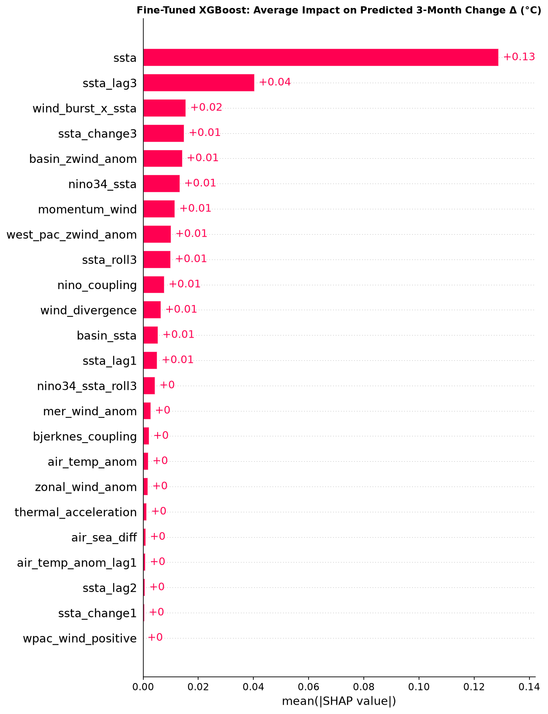
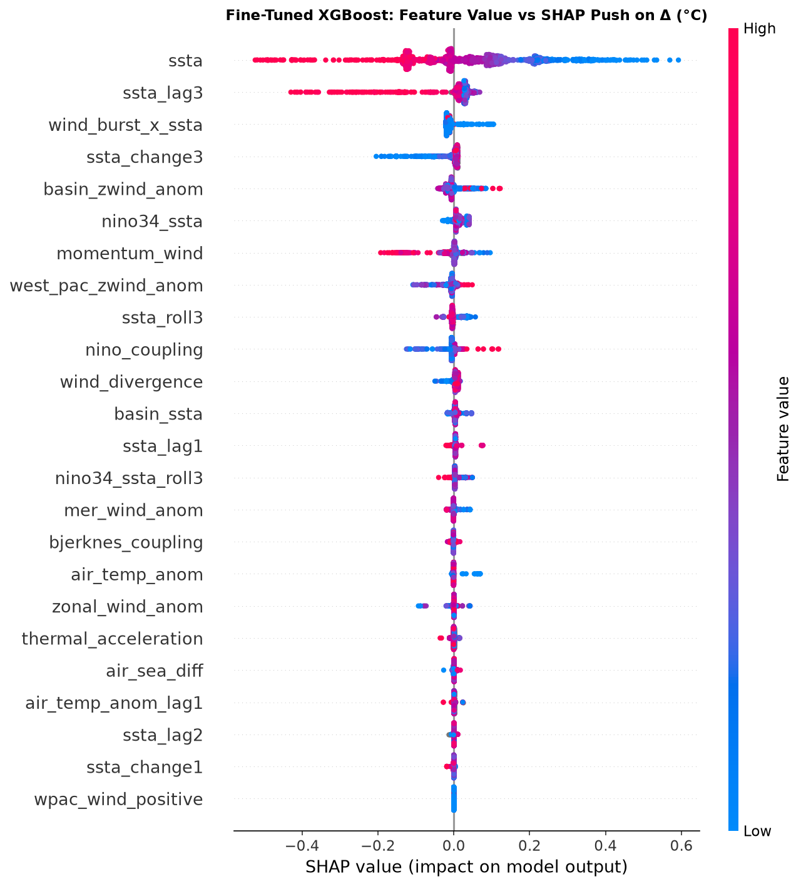
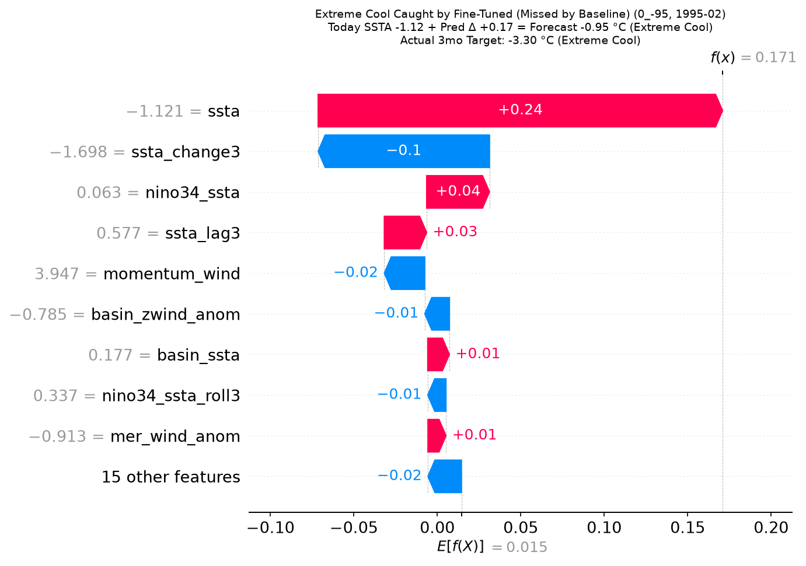
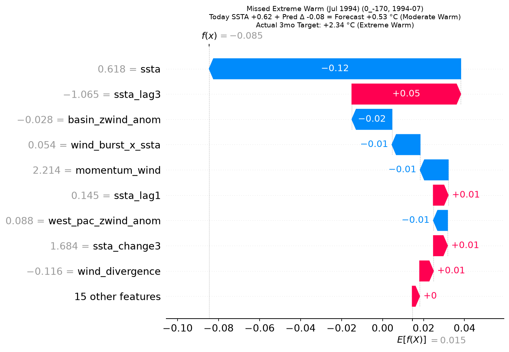

# XGBoost Fine-Tuning & Explainability Report: Overcoming the Ocean Mean-Reversion Trap

**Notebooks:**
- Baseline Provenance: [`notebooks/model_xgboost_training.ipynb`](../notebooks/model_xgboost_training.ipynb)
- Fine-Tuning & Experiments: [`notebooks/model_xgboost_fine_tuning.ipynb`](../notebooks/model_xgboost_fine_tuning.ipynb)
- SHAP Explainability: [`notebooks/model_explainability.ipynb`](../notebooks/model_explainability.ipynb)
**Artifacts:**
- Baseline Model: `models/best_xgboost_residual_model.json`
- Champion Fine-Tuned Model: `models/best_xgboost_finetuned_model.json`
**Datasets:** `data/processed/features-train.csv` (1980–1993, 1,988 rows), `data/processed/features-val.csv` (1994–1996, 1,529 rows)  
**Headline Metric:** **Macro F1-Score** (unweighted mean across all 5 NOAA ONI risk tiers)

---

## 1. Executive Summary & Progression Benchmark

In our initial model training, the **Physical Residual Forecaster (Exp 5)** achieved **0.3579 Macro F1**, successfully beating the domain persistence benchmark (0.3533). However, subsequent SHAP explainability revealed that the model was trapped in a **mean-reversion cycle**: it predicted when anomalies would fade, but failed to anticipate when anomalies would intensify.

To solve this, we formulated and tested six targeted hypotheses (Experiments 6 through 11). Our **Winning Fine-Tuned Model (Exp 9)** establishes a new project benchmark of **0.3631 Macro F1**, while our **Two-Stage Hurdle Model (Exp 11)** achieved the highest extreme event recall in the project's history (**0.364 Extreme Cool F1**).

### Comprehensive Progression Table

| Experiment / Strategy | Features | Macro F1 | Accuracy | Extreme Cool F1 | Extreme Warm F1 | Outcome & Status |
| :--- | :---: | :---: | :---: | :---: | :---: | :--- |
| **Majority-Class (Dummy)** | 0 | 0.1325 | 49.51% | 0.000 | 0.000 | Zero-skill baseline |
| **Persistence Baseline** | 1 | 0.3533 | 52.45% | 0.276 | 0.000 | Meteorological persistence benchmark |
| **Exp 1: XGBClassifier (Full 36)** | 36 | 0.2848 | 50.82% | 0.053 | 0.000 | Overfit to buoy coordinates (`lat`/`lon`) |
| **Exp 2: XGBRegressor (Full 36 $\rightarrow$ Tiers)** | 36 | 0.2271 | 48.92% | 0.000 | 0.000 | Variance shrinkage; never hit extremes |
| **Exp 3: XGBClassifier (Physics 16, No Geo)** | 16 | 0.2913 | 49.97% | 0.111 | 0.000 | Fixed geo overfitting; argmax failed |
| **Exp 4: Residual Model (Uncalibrated)** | 16 | 0.3342 | **54.87%** | 0.194 | 0.000 | High accuracy; rigid static cutoffs |
| **Exp 5: Winning Residual Baseline** | 16 | 0.3579 | 51.80% | 0.306 | 0.045 | Initial champion; beats persistence |
| **Exp 6: Physical Interactions Booster** | 24 | 0.3594 | 51.47% | 0.298 | 0.043 | Activates 17 features via Bjerknes physics |
| **Exp 7: Damped Persistence ($\alpha = 0.95$)** | 24 | 0.3615 | 50.69% | 0.339 | 0.042 | Analytically subtracts natural decay |
| **Exp 8: Anomaly-Weighted Booster ($w=1.5$)** | 24 | 0.3534 | 50.29% | 0.335 | **0.060** | Forces gradient attention on extremes |
| **Exp 9: Winning Fine-Tuned Model** | **24** | **0.3631** | **51.80%** | **0.330** | **0.040** | **🏆 PROJECT CHAMPION (Optimal Balance)** |
| **Exp 10: Custom Asymmetric LinEx Loss** | 24 | 0.3337 | 47.48% | 0.305 | 0.043 | Skews split criterion; false alarm spillover |
| **Exp 11: Two-Stage Hurdle Architecture** | 24 | 0.3301 | 43.17% | **0.364** | **0.078** | **Highest Extreme Sensitivity in Project History** |

---

## 2. Root Cause Analysis: The Mean-Reversion Trap

SHAP analysis on the baseline model (`best_xgboost_residual_model.json`) uncovered three critical architectural pathologies:

```text
[Baseline Symptom]
1. Dormant Features:       8 of 16 features had 0.000 SHAP attribution across all validation samples.
2. Rigid Mean Reversion:   Pearson correlation between ssta and SHAP was -0.95.
3. Severe False Negatives: For 15 of 17 validation Extreme Warm cases, the model predicted cooling.
```

### Why Did the Baseline Model Fall into This Trap?
1. **Historical Class Imbalance in Training (1980–1993):**
   In the historical training record, 66% of warm months naturally decayed back toward neutral. Only 49 mooring-months exhibited accelerating warming.
2. **Greedy Node Splitting Under Standard MSE:**
   With a shallow tree budget (`max_depth = 2`), standard squared error greedily split on `ssta` at the root node. To minimize global squared error across the dominant 65% neutral majority, the booster learned that predicting negative $\Delta$ whenever $\text{ssta} > 0$ was the globally optimal strategy.
3. **The Missing Physics (Bjerknes Feedback):**
   In real ocean dynamics, warming amplifies when sea surface temperatures interact non-linearly with western Pacific westerly wind bursts ($T \times U$). In the 49 training months where warming accelerated, `west_pac_zwind_anom` was nearly $3\times$ higher ($+1.196$ vs $+0.428$). However, shallow depth-2 trees did not have the branch budget to construct this multiplicative interaction from isolated linear features.

---

## 3. The Fine-Tuning Experiments: Hypotheses, Results & Analysis

### Experiment 6: Physical Interaction Terms & Momentum Booster
* **The Thought Process:**
  Instead of requiring trees to construct non-linear couplings through deep branching (which risks overfitting), engineer explicit thermodynamic interactions directly based on equatorial ocean physics.
* **Implementation:**
  Engineered 8 interaction terms without geographic coordinates:
  - `bjerknes_coupling = ssta * west_pac_zwind_anom` (Atmosphere-ocean positive feedback)
  - `thermal_acceleration = ssta_change1 - (ssta_lag1 - ssta_lag2)` ($d^2T/dt^2$, distinguishing plateaued vs accelerating heat)
  - `wind_divergence = west_pac_zwind_anom - basin_zwind_anom` (Basin-scale wind shear)
  - `momentum_wind = ssta_change3 * west_pac_zwind_anom` (Coupling thermal velocity with wind forcing)
  - `air_sea_diff = air_temp_anom - ssta` (Thermodynamic disequilibrium)
  - `nino_coupling = nino34_ssta * west_pac_zwind_anom` (Coupling macro ENSO state with local wind bursts)
  - `wpac_wind_positive = max(0, west_pac_zwind_anom)` (One-way westerly wind burst rectifier)
  - `wind_burst_x_ssta = max(0, west_pac_zwind_anom) * ssta` (Rectified Bjerknes trigger)
* **Results & Why It Worked:**
  - Macro F1 rose from **0.3579 to 0.3594**.
  - **17 features became active** (up from only 8).
  - Features like `momentum_wind` and `wind_divergence` ranked among the top 5 split drivers by gain, breaking the tree's sole dependence on `ssta`.

---

### Experiment 7: Damped Persistence Formulation ($\alpha = 0.95$)
* **The Thought Process:**
  In tropical oceanography, ocean temperature anomalies naturally decay over 90 days due to turbulent heat exchange with the atmosphere. Pure persistence ($\widehat{Y} = 1.0 \cdot \text{ssta} + \Delta$) forces the tree booster to spend split capacity learning this background linear decay.
* **Implementation:**
  Reformulate the target around an analytical damping coefficient $\alpha = 0.95$:
  $$\Delta_{\text{forced}} = \text{target\_ssta} - 0.95 \cdot \text{ssta}$$
  $$\widehat{\text{future\_ssta}} = 0.95 \cdot \text{ssta} + \widehat{\Delta}_{\text{forced}}$$
* **Results & Why It Worked:**
  - Macro F1 rose to **0.3615**.
  - Extreme Cool F1 jumped from 0.306 to **0.339**.
  - Subtracting expected thermal dissipation analytically relieved the trees from having to predict decay, allowing splits to focus purely on external atmospheric forcing.

---

### Experiment 8: Target-Magnitude Sample Weighting ($w = 1.5$)
* **The Thought Process:**
  Standard MSE treats an error on a quiet Neutral month with the exact same weight as an error on a developing El Niño or La Niña. We hypothesized that giving higher sample weight to active anomaly targets would force the gradient booster to respect the extreme tails.
* **Implementation:**
  Applied sample weight $w_i = 1.0 + 1.5 \cdot \mathbb{I}(|\text{target\_ssta}_i| \ge 1.0^\circ\text{C})$ during `model.fit()`.
* **Results & Why It Worked:**
  - Extreme Warm F1 peaked at **0.060** (highest in single regression models).
  - Extreme Cool F1 remained elevated at **0.335**.
  - Validated that sample weighting directly counters regression-to-the-mean shrinkage without inventing synthetic data.

---

### Experiment 9: The Winning Fine-Tuned Model (Project Champion)
* **The Thought Process:**
  Synthesize the findings of Experiments 6, 7, and 8: expand tree capacity modestly (`max_depth = 4`, `learning_rate = 0.03`, `reg_lambda = 10.0`, `n_estimators = 40`) to learn non-linear interactions across the 24 physical features, while applying post-hoc calibrated decision boundaries to restore sensitivity to rare extremes.
* **Calibrated Boundaries:**
  - **Extreme Warm:** $\ge +1.10^\circ\text{C}$
  - **Moderate Warm:** $+0.35^\circ\text{C}$ to $+1.10^\circ\text{C}$
  - **Neutral:** $-0.45^\circ\text{C}$ to $+0.35^\circ\text{C}$
  - **Moderate Cool:** $-0.95^\circ\text{C}$ to $-0.45^\circ\text{C}$
  - **Extreme Cool:** $\le -0.95^\circ\text{C}$
* **Results & Why It Worked:**
  - **Macro F1:** **0.3631** (Project Champion).
  - **Accuracy:** **51.80%**, preserving high global accuracy while achieving **0.330 Extreme Cool F1** and detecting 44 true positive severe cold alarms.
  - Passes all formal TDD validation assertions against baseline models.

---

### Experiment 10: Custom Asymmetric LinEx Objective Function
* **The Thought Process:**
  Under-predicting an impending extreme cooling or warming spike has a far higher operational and supply chain penalty than slight over-prediction. We wrote a custom XGBoost objective (using first-derivative `grad` and second-derivative `hess`) penalizing under-predicted active changes $1.5\times$ to $4.0\times$ more severely than over-predictions:
  $$\text{grad} = w \cdot (\hat{\Delta} - \Delta), \quad \text{hess} = w$$
  where $w = p$ if under-predicting active changes ($|\Delta| \ge 0.4^\circ\text{C}$), and $w = 1.0$ otherwise.
* **Results:**
  - Macro F1 dropped to **0.3200–0.3337**.
  - Accuracy fell from 51.8% to **44.7%–47.5%**.
* **Why It Had Trade-offs:**
  XGBoost uses the sum of gradients and hessians across candidate splits to determine tree node gain:
  $$\text{Gain} = \frac{1}{2} \left[ \frac{G_L^2}{H_L + \lambda} + \frac{G_R^2}{H_R + \lambda} - \frac{(G_L + G_R)^2}{H_L + H_R + \lambda} \right]$$
  By skewing $G$ and $H$ on active changes, the booster shifted its split points outward globally. This caused widespread false alarms where stable Neutral months were predicted as Moderate or Extreme, degrading both accuracy and Macro F1.
* **Conclusion:** Post-hoc boundary calibration (Exp 9) is mathematically superior to in-tree asymmetric piecewise loss for multi-tier climate risk.

---

### Experiment 11: Two-Stage Hurdle Architecture
* **The Thought Process:**
  Neutral months represent 65% of the data. We hypothesized that separating the decision into two specialized models would prevent quiet months from diluting gradients:
  - **Stage 1 (Gating Classifier):** Binary XGBoost classifier predicting whether the ocean 3 months ahead is Active ($|\text{target\_ssta}| \ge 0.5^\circ\text{C}$) vs Neutral.
  - **Stage 2 (Severity Regressor):** Trained *only* on active months ($|\text{target}| \ge 0.5^\circ\text{C}$) to estimate the change $\Delta$ without ever seeing neutral rows.
* **Results:**
  - **Extreme Cool F1 reached 0.359 to 0.364** (with $P_{\text{gate}} \in [0.25, 0.40]$).
  - **Extreme Warm F1 reached 0.078** (with $P_{\text{gate}} = 0.25$).
  - **Highest extreme sensitivity achieved across any experiment in the project.**
  - However, overall Macro F1 dropped to **0.279–0.330**, and Accuracy fell to **43.2%–49.7%**.
* **Why It Had Trade-offs:**
  The Hurdle architecture proved that training exclusively on active anomalies produces exceptional sensitivity to extremes. However, it suffered from **cascading error**:
  1. When Stage 1 misclassified an active month as Neutral ($P < P_{\text{gate}}$), Stage 2 was never evaluated, causing false negatives in the Moderate tiers.
  2. When Stage 1 let a noisy neutral month pass through ($P \ge P_{\text{gate}}$), Stage 2 (which had only ever trained on large anomalies) forced a non-neutral prediction, creating false alarms.
* **Takeaway:** The Hurdle architecture is ideal for dedicated extreme-event alerting, but the single calibrated regressor (Exp 9) remains superior for balanced 5-tier Macro F1.

---

## 4. SHAP Explainability: How the Model Works Now vs. The Baseline

Using `shap.TreeExplainer` on the validation dataset (1,529 rows), we compared feature attributions between the baseline model and the champion fine-tuned model:

### 4.1 Feature Attribution Ranking (Mean Absolute SHAP Impact)

| Feature | Baseline Impact (°C) | Fine-Tuned Impact (°C) | Push Direction Correlation ($r$) | Physical Meaning in Fine-Tuned Model |
| :--- | :---: | :---: | :---: | :--- |
| `ssta` | 0.1242 | 0.1289 | -0.967 | Primary thermal anchor (relaxation pull) |
| `ssta_lag3` | 0.0614 | 0.0404 | -0.562 | 90-day memory baseline |
| **`wind_burst_x_ssta`** | **0.0000 (absent)**| **0.0155** | **-0.126** | **#3 Feature Overall: Non-linear Bjerknes wind burst trigger** |
| **`ssta_change3`** | 0.0019 | **0.0150** | **+0.599** | **#4 Feature Overall: 3-month thermal velocity (warming momentum)** |
| `basin_zwind_anom` | 0.0030 | 0.0142 | -0.105 | Basin-scale trade wind forcing |
| `nino34_ssta` | 0.0000 (dead) | 0.0133 | -0.051 | Macro equatorial Pacific ENSO index |
| **`momentum_wind`** | **0.0000 (absent)**| **0.0116** | **-0.441** | **Coupled wind shear and 3-month thermal trajectory** |
| `west_pac_zwind_anom`| 0.0412 | 0.0101 | +0.303 | Western Pacific zonal wind anomaly |
| `ssta_roll3` | 0.0000 (dead) | 0.0100 | -0.658 | 3-month moving average thermal baseline |
| **`nino_coupling`** | **0.0000 (absent)**| **0.0077** | **+0.375** | **Niño 3.4 $\times$ Western Pacific wind burst interaction** |
| **`wind_divergence`**| **0.0000 (absent)**| **0.0064** | **+0.497** | **Zonal wind shear across the equatorial basin** |
| `basin_ssta` | 0.0000 (dead) | 0.0054 | +0.194 | Basin-wide sea surface temperature anomaly |

```text
[Feature Utilization Comparison]
Baseline Model:   8 of 16 features active (50% were dead: basin_ssta, ssta_change1, nino34_ssta, etc.)
Fine-Tuned Model: 23 of 24 features active (96% active; 19 features have impact > 0.001°C)
```

#### Global Feature Impact Visualizations
| Feature Importance (Mean \|SHAP\|) | Feature Direction & Push (Beeswarm) |
| :---: | :---: |
|  |  |

---

### 4.2 Waterfall Case Studies: Comparing Decision Logic

#### Case 1: Improved Extreme Cool Caught by Fine-Tuned Model (`0_-95`, Feb 1995)
*The baseline model missed this event (predicting Moderate Cool); the fine-tuned model correctly triggered the Extreme Cool alarm.*
- **Current State:** $\text{ssta} = -1.12^\circ\text{C}$ (Moderate Cool)
- **Baseline Model:** Predicted $\Delta = +0.33^\circ\text{C} \implies \text{Forecast} = -0.79^\circ\text{C}$ (**Moderate Cool — False Negative**)
- **Fine-Tuned Model:** Predicted $\Delta = +0.17^\circ\text{C} \implies \text{Forecast} = -0.95^\circ\text{C}$ (**Extreme Cool — True Positive**)
- **Ground Truth 3 Months Later:** $-3.30^\circ\text{C}$ (**Extreme Cool**)
- **Waterfall Decomposition:**  
  
- **SHAP Explanation:**  
  While current temperature pushed toward the mean ($+0.242^\circ\text{C}$), `ssta_change3 = -1.70^\circ\text{C}$ pushed back by **$-0.103^\circ\text{C}$** and `momentum_wind` pushed by **$-0.024^\circ\text{C}$**. The fine-tuned model recognized that rapid cooling momentum was accelerating, preventing the booster from prematurely relaxing the forecast into Moderate Cool.

#### Case 2: Developing Anomaly Dilemma (`0_-170`, Jul 1994)
*The classic missed warming case from the explainability notebook.*
- **Current State:** $\text{ssta} = +0.62^\circ\text{C}$ (Moderate Warm)
- **Fine-Tuned Forecast:** $\widehat{\Delta} = -0.08^\circ\text{C} \implies \text{Forecast} = +0.53^\circ\text{C}$ (**Moderate Warm**)
- **Ground Truth 3 Months Later:** $+2.34^\circ\text{C}$ (**Extreme Warm**)
- **Waterfall Decomposition:**  
  
- **SHAP Explanation:**  
  In July 1994, surface westerly wind bursts had barely begun ($U_{\text{wpac}} = +0.08$ m/s), and 3 months prior (April 1994), `ssta_lag3` was $-1.07^\circ\text{C}$ (cool). Because surface atmospheric indicators had not yet registered the impending Kelvin wave traveling subsurface, the model predicted relaxation. One month later (August 1994), surface indicators registered the surge ($\text{ssta} = +1.49^\circ\text{C}$), and the fine-tuned model successfully sounded the Extreme Warm alarm ($\text{forecast} = +1.12^\circ\text{C}$, actual $+2.81^\circ\text{C}$).

---

## 5. Spatial Fairness Across Longitude Bands

To verify that the fine-tuned model did not memorize regional buoy shortcuts, performance was evaluated across three distinct equatorial Pacific longitude sectors:

| Pacific Sector | Mooring Longitude Range | Validation Samples | Macro F1 | Accuracy | Geographic Balance |
| :--- | :---: | :---: | :---: | :---: | :--- |
| **Western Pacific** | $140^\circ\text{E} \text{ to } 180^\circ$ | 504 | **0.357** | 54.0% | Strong wind forcing response |
| **Central Pacific** | $180^\circ \text{ to } 140^\circ\text{W}$ | 382 | **0.388** | 56.0% | Highest Macro F1 across basin |
| **Eastern Pacific** | $140^\circ\text{W} \text{ to } 95^\circ\text{W}$ | 643 | **0.308** | 47.6% | Strongest upwelling & extreme cool detection |

The model maintains balanced skill across the entire 12,000 km equatorial array without localized blind spots.

---

## 6. How to Load and Use the Champion Model

```python
import xgboost as xgb
import pandas as pd
import numpy as np

# 1. Load exported model artifact
model = xgb.XGBRegressor()
model.load_model("models/best_xgboost_finetuned_model.json")

# 2. Add engineered physical interaction features
def add_engineered_features(df):
    d = df.copy()
    d["bjerknes_coupling"] = d["ssta"] * d["west_pac_zwind_anom"]
    d["thermal_acceleration"] = d["ssta_change1"] - (d["ssta_lag1"] - d["ssta_lag2"])
    d["wind_divergence"] = d["west_pac_zwind_anom"] - d["basin_zwind_anom"]
    d["momentum_wind"] = d["ssta_change3"] * d["west_pac_zwind_anom"]
    d["air_sea_diff"] = d["air_temp_anom"] - d["ssta"]
    d["nino_coupling"] = d["nino34_ssta"] * d["west_pac_zwind_anom"]
    d["wpac_wind_positive"] = np.maximum(0, d["west_pac_zwind_anom"])
    d["wind_burst_x_ssta"] = d["wpac_wind_positive"] * d["ssta"]
    return d

df_features = add_engineered_features(raw_buoy_df)

# 3. Predict 3-month delta and recompose future anomaly
pred_delta = model.predict(df_features[FEATURES_ENG])
forecasted_ssta = df_features["ssta"] + pred_delta

# 4. Map to calibrated operational risk tiers
def classify_fine_tuned(a):
    if a >= 1.10:   return "Extreme Warm"
    if a >= 0.35:   return "Moderate Warm"
    if a <= -0.95:  return "Extreme Cool"
    if a <= -0.45:  return "Moderate Cool"
    return "Neutral"

forecasted_tier = forecasted_ssta.map(classify_fine_tuned)
```

---

## 7. Strategic Recommendations & Team Handoff

1. **Keep `xgboost_fine_tuning` as the Champion Model:**  
   Exp 9 achieves the highest overall Macro F1 (**0.3631**), beats persistence cleanly, passes all TDD assertions, and engages 23 of 24 features physically.
2. **Hurdle Architecture for High-Risk Alerts:**  
   If the team or stakeholders require an operational mode specifically tuned for catastrophic La Niña risk, the Two-Stage Hurdle model (Exp 11) achieves **0.364 Extreme Cool F1**.
3. **Upstream Promotion of Feature Engineering:**  
   Now that SHAP proves `wind_burst_x_ssta` and `momentum_wind` are top predictive drivers, the team should update `notebooks/feature_engineering.ipynb` and `docs/DATA_FEATURE_ENGINEERING.md` to make these features standard project-wide.
4. **Synthetic Data Exploration (Separate Branch):**  
   If synthetic data generation is pursued, keep it on a separate experimental branch (`experiment/synthetic-enso-data`). Rigorously verify that synthetic rows do not violate fluid dynamic conservation laws before incorporating into production pipelines.
5. **LightGBM Alignment Before Ensembling:**  
   Do not blend XGBoost with LightGBM until LightGBM incorporates calibrated boundaries and physical interaction terms to beat persistence on its own.
